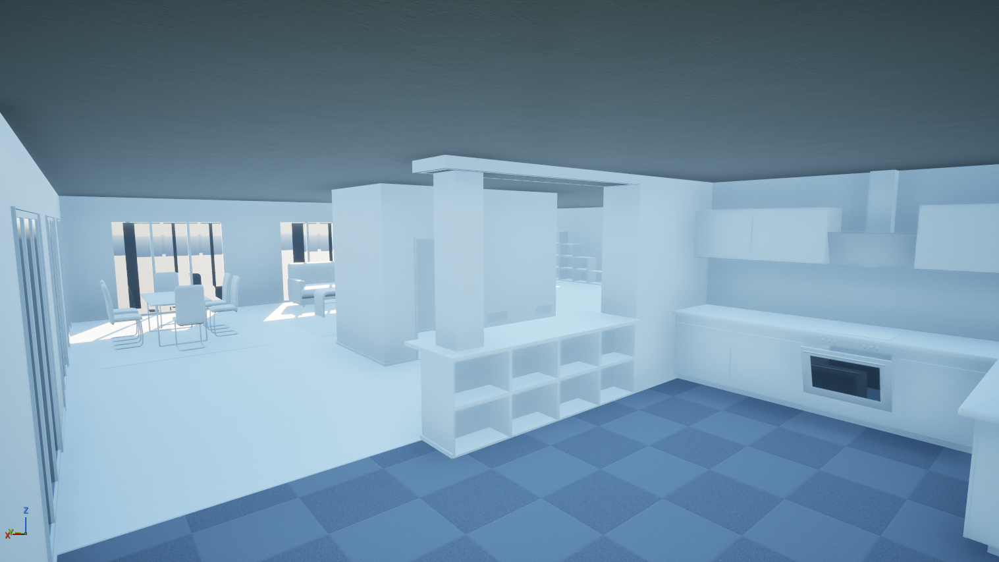
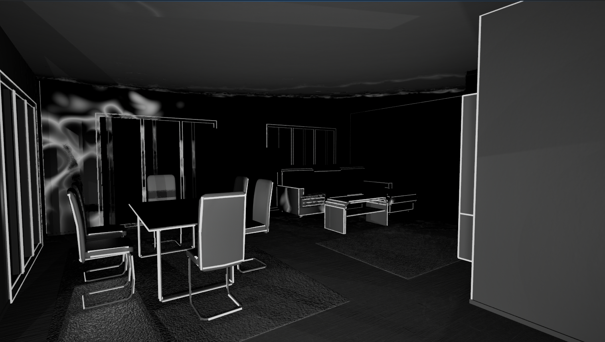

# UnnamedATM (WIP)

First-person prototype in Unreal Engine 5.6 where the world is pitch dark and only revealed by sound waves.

## Controls
- Right mouse button: emit a sonar pulse
- Ctrl: crouch (smaller footstep waves)

## Features
- Travelling waves: moving lights whose ring, afterglow and noisy front come from a light function
- Footstep waves triggered by animation notifies when the foot touches the ground
- Echoes: mirrored light sources clipped to the reflecting face
- Occlusion and distance attenuation
- Persistent edge reveal: edges stay lit, then fade, with brightness set by the wave strength
- Light-only post-process: only shapes and normal-mapped details are visible

## Architecture (C++)
- `AWave`: one wave (point light + light function), reveals receivers and spawns echoes
- `UWaveReceiverComponent`: makes a mesh react to waves (edge visibility, reflectivity, echoes)
- `AEdgeRenderer`: draws all revealed edges with one instanced static mesh
- `UMeshEdgesAsset`: extracts the meaningful edges of a mesh in the editor

## Setup
Requires Unreal Engine 5.6.1, Visual Studio 2022 (C++ game development) and Git LFS.
